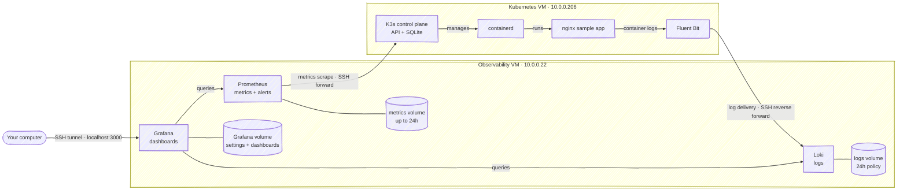

# SRE practice lab

A small Kubernetes and observability lab on two Oracle Cloud VMs. Each VM has 1 GB RAM, so the lab may slow down under load.

## Lab at a glance

| VM | Runs | Private IP |
| --- | --- | --- |
| Kubernetes | K3s, an nginx sample app, and Fluent Bit | `10.0.0.206` |
| Observability | Prometheus, Grafana, and Loki in Docker Compose | `10.0.0.22` |



The VMs use a private SSH tunnel for metrics and logs. Your computer uses a separate SSH tunnel for Grafana.

## Open Grafana

Replace `OBSERVABILITY_PUBLIC_IP` with your VM’s public IP, then run this on your computer:

```sh
ssh -N -L 3000:127.0.0.1:3000 ubuntu@OBSERVABILITY_PUBLIC_IP
```

Open [localhost:3000](http://127.0.0.1:3000). The username is `admin`. To see the initial password, run:

```sh
ssh ubuntu@OBSERVABILITY_PUBLIC_IP "sudo sed -n 's/^GF_SECURITY_ADMIN_PASSWORD=//p' ~/sre-lab/observability/.env"
```

The dashboard is **Lab / SRE Practice Lab**. It shows container metrics, application logs, and firing alerts. Alerts do not send notifications; no notification destination is configured.

## Check the lab

Replace `KUBERNETES_PUBLIC_IP` and `OBSERVABILITY_PUBLIC_IP` with your VM addresses in these commands.

Kubernetes VM:

```sh
ssh ubuntu@KUBERNETES_PUBLIC_IP
sudo systemctl status k3s
sudo k3s kubectl get nodes,pods -A
free -h
```

Observability VM:

```sh
ssh ubuntu@OBSERVABILITY_PUBLIC_IP
cd ~/sre-lab/observability
sudo docker compose --profile metrics --profile logging ps
sudo systemctl status sre-lab-tunnel
sudo docker stats --no-stream
```

## Start and stop

K3s is disabled at boot to protect the small VM. Start it when needed:

```sh
sudo systemctl start k3s
```

Stop it with `sudo systemctl stop k3s`. **Stopping K3s may leave its containers running.** Check the processes and stop lab containers as needed. k0s is also installed for a previous trial; it is stopped and disabled. Do not run K3s and k0s at the same time.

On the observability VM, use these commands from `~/sre-lab/observability` if you need to run one backend at a time:

```sh
# Metrics only
sudo docker compose --profile logging stop loki
sudo docker compose --profile metrics up -d prometheus

# Logs only
sudo docker compose --profile metrics stop prometheus
sudo docker compose --profile logging up -d loki

# Both
sudo docker compose --profile metrics --profile logging up -d
```

When a backend is stopped, its dashboard panels and collection have gaps. Fluent Bit's buffer is limited, so logs can be lost during a long Loki outage.

## Storage and limits

- Prometheus keeps metrics for up to 24 hours, subject to a 1 GB size limit. Loki has a 24-hour log retention policy; deletion is not immediate. Neither policy has been verified by waiting a full day.
- Grafana, Prometheus, and Loki use persistent Docker volumes.
- CoreDNS and dynamic persistent storage are disabled on K3s. Pods do not have cluster DNS.
- K3s uses experimental memory settings. It is below the [documented 2 GB server minimum](https://docs.k3s.io/installation/requirements), and a full stability test has not been completed.
- `vm.swappiness=10` is temporary and resets after reboot. The K3s memory settings and `MemoryHigh=500M` are configured in `/etc/systemd/system/k3s.service.d/90-sre-lab-tuning.conf`.

## Component choices

| Component | Why we use it | Alternative |
| --- | --- | --- |
| K3s and containerd | Small Kubernetes distribution with a bundled container runtime. | k0s was tested but its application deployment stalled. |
| SQLite | K3s's single-node datastore needs no separate database server. | etcd supports highly available clusters. |
| Fluent Bit and Loki | Collect and store the requested application logs. | Grafana Alloy or OpenTelemetry Collector can collect logs; Elasticsearch/OpenSearch offer different search capabilities. |
| Prometheus and Grafana | Collect metrics, evaluate alerts, and show the requested dashboard. | VictoriaMetrics is another metrics backend; the Prometheus UI can query metrics without Grafana. |
| Docker Compose | Runs the requested observability stack on the second VM. | Separate systemd services avoid Docker overhead but need individual management. |
| SSH tunnels | Secure Grafana access and telemetry between VMs. | Tailscale can simplify access from multiple devices but adds a daemon and account setup; it is not installed. |
| Disk-backed swap | Helps keep the VMs reachable during memory spikes. | Compressed swap trades CPU for less disk I/O; a short zswap trial was inconclusive. |

Configuration files are in `kubernetes/`, `observability/`, and `host-config/`. For past measurements and tuning details, see [setup and test history](reports/setup-history.md) and the [partial soak samples](reports/soak-2026-11-24/vmstat.txt).
